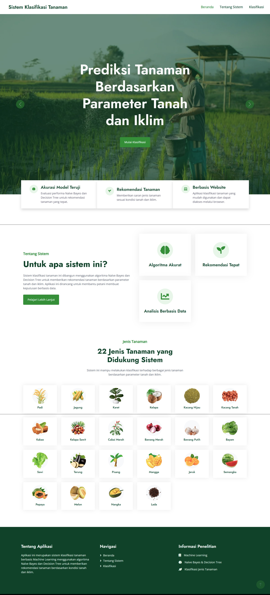
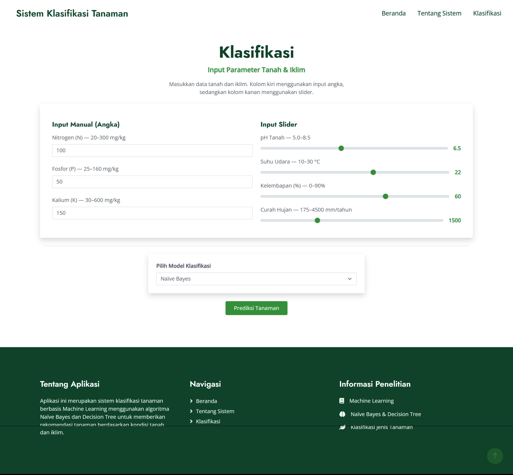
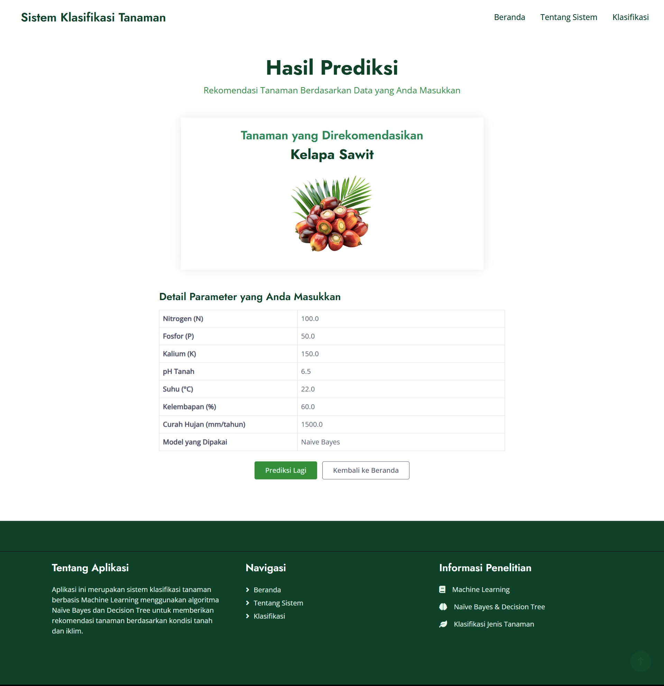

# Crop Classification Using Machine Learning

### Soil and Climate-Based Crop Classification with Naïve Bayes and Decision Tree

**Undergraduate Research Project · Universitas Muhammadiyah Pontianak · 2025**

A research-based web application for classifying suitable crop types using
soil nutrient measurements and environmental conditions. The project compares
two machine learning algorithms and makes their predictions accessible through
an interactive Streamlit interface.

 

**Python** &nbsp;·&nbsp; **Streamlit** &nbsp;·&nbsp; **Scikit-learn** &nbsp;·&nbsp; **Pandas** &nbsp;·&nbsp; **Machine Learning**

 

[Overview](#overview) &nbsp;·&nbsp;
[Application](#application-showcase) &nbsp;·&nbsp;
[Methodology](#research-methodology) &nbsp;·&nbsp;
[Results](#experimental-results) &nbsp;·&nbsp;
[Technology](#technology-stack) &nbsp;·&nbsp;
[Source Access](#source-code-access)

---

## Overview

Selecting a crop that matches local soil and climate conditions is an important
consideration in agricultural planning. Soil nutrients, acidity, temperature,
humidity, and rainfall provide useful information for assessing which crop types
are more suitable for a given set of environmental conditions.

This project, titled **"Implementasi Machine Learning untuk Klasifikasi Jenis
Tanaman Berdasarkan Parameter Tanah dan Iklim Menggunakan Naïve Bayes dan
Decision Tree,"** investigates the use of supervised machine learning for
multiclass crop classification.

Two algorithms, **Gaussian Naïve Bayes** and **Decision Tree**, are developed,
evaluated, and integrated into a **Streamlit-based web application**. The system
allows users to enter soil and climate parameters, select a classification
model, and view its predicted crop type.

### Project at a Glance

| | |
|:---|:---|
| **Research Domain** | Precision Agriculture / Machine Learning |
| **Research Year** | 2025 |
| **Dataset** | Crop Yield Production (Kaggle) |
| **Dataset Size** | 2,200 records |
| **Input Features** | 7 soil and climate parameters |
| **Target Classes** | 22 crop types |
| **Algorithms** | Gaussian Naïve Bayes and Decision Tree |
| **Research Framework** | CRISP-DM |
| **Validation** | Train-test evaluation and 10-fold cross-validation |
| **Web Application** | Streamlit |

---

## Application Showcase

The interactive application translates the classification models into a
user-facing interface. It provides crop classification, dataset exploration,
and performance evaluation in a single web environment.

### 01 / Home

**An introduction to soil- and climate-based crop classification.**

The home page introduces the research objective, supported crop types,
classification methods, and environmental parameters used by the system.

  

Figure 01 — Application Home Page

 

### 02 / Crop Classification

**From environmental measurements to model-based crop predictions.**

Users enter seven soil and climate variables: nitrogen, phosphorus, potassium,
temperature, humidity, soil pH, and rainfall. They can then choose between the
Naïve Bayes and Decision Tree models to perform classification.

  

Figure 02 — Crop Classification Interface

 

### 03 / Classification Result

**A clear presentation of the predicted crop type.**

After the input values are processed, the application displays the crop type
predicted by the selected model, supported by relevant crop information and
visual documentation.

  

Figure 03 — Crop Classification Result

 

### 04 / Data Visualization

**Exploring patterns in the research dataset.**

The visualization module helps users understand the underlying observations
through data tables, crop-label distributions, pie charts, scatter plots,
and a correlation heatmap for numerical features.

### 05 / Model Evaluation

**Comparing classification performance transparently.**

The evaluation module presents accuracy, precision, recall, F1-score,
confusion matrices, and 10-fold cross-validation results for both algorithms.
It supports comparison of model performance and stability.

---

## Research Methodology

### Research Design

The study follows the **Cross-Industry Standard Process for Data Mining
(CRISP-DM)** framework, covering six stages:

**Business Understanding → Data Understanding → Data Preparation → Modeling → Evaluation → Deployment**

The workflow includes dataset exploration, preprocessing, model training,
performance comparison, and deployment within the Streamlit application.

### Dataset and Input Features

The dataset contains **2,200 observations**, with seven numerical input
features and one categorical target representing **22 crop types**. It was
obtained from a public Kaggle dataset and assessed against agricultural land
evaluation references described in the thesis.

| Feature | Description |
|:---|:---|
| Nitrogen (N) | Soil nitrogen content |
| Phosphorus (P) | Soil phosphorus content |
| Potassium (K) | Soil potassium content |
| Temperature | Ambient temperature |
| Humidity | Relative humidity |
| pH | Soil acidity or alkalinity |
| Rainfall | Rainfall conditions |

**Dataset reference:** [Crop Yield Production — Kaggle](https://www.kaggle.com/datasets/kevinsmith94624/crop-yield-production)

### Classification Models

**Gaussian Naïve Bayes** is a probabilistic classifier that applies Bayes'
theorem under conditional independence assumptions. **Decision Tree** learns a
sequence of decision rules from the input features to assign crop classes.

The Decision Tree model was tuned with grid search, and both algorithms were
assessed using train-test evaluation and **10-fold cross-validation**.

---

## Experimental Results

### Classification Performance

The following results are reported in the completed undergraduate thesis.

| Model | Training Accuracy | Testing Accuracy | 10-Fold CV Accuracy |
|:---|---:|---:|---:|
| **Naïve Bayes** | 95.25% | **95.32%** | **94.81%** |
| Decision Tree | **97.95%** | 91.57% | 93.45% |

*Testing accuracy is measured on held-out data, while cross-validation
accuracy represents the average across validation folds.*

### Key Findings

**01 — Comparative performance.** Decision Tree achieved higher training
accuracy, but its performance decreased on the testing set.

**02 — Model stability.** Naïve Bayes showed more consistent performance
between training and testing, as well as a higher mean cross-validation
accuracy.

**03 — Selected approach.** Based on these results, the thesis recommends
Naïve Bayes as the more stable model for the evaluated classification task.

### Research Scope and Limitations

The application is a **research prototype** developed and evaluated using
secondary data. The study does not report field validation with farmers or
real-time soil and climate sensor measurements. Model predictions should
therefore be interpreted as research-based classifications rather than
guaranteed agronomic recommendations.

---

## Technology Stack

| Component | Technologies |
|:---|:---|
| **Programming Language** | Python |
| **Web Application** | Streamlit |
| **Machine Learning** | Scikit-learn (GaussianNB, DecisionTreeClassifier) |
| **Data Processing** | Pandas, NumPy |
| **Model Serialization** | Pickle |
| **Interface** | Streamlit components and HTML styling |

---

## Repository Scope

This repository serves as a **public-facing research and software development
portfolio**. It documents the application's purpose, interface, methodology,
and summarized experimental findings.

The full application source code, trained models, and working datasets are **not
publicly distributed** in this repository.

## Source Code Access

For academic collaboration, project inquiries, or requests regarding source
code availability, please contact the developer:

**Email:** [ronn.7ex@gmail.com](mailto:ronn.7ex@gmail.com)  
**WhatsApp:** [+62 858-4960-4654](https://wa.me/6285849604654)

Access is subject to the developer's approval.

---

## Author

**Roni, S.Kom.**  
Machine Learning · Applied Data Science · Web Development

---

Crop Classification Using Machine Learning · Undergraduate Research, 2025

 

Research & Software Development Portfolio — Roni, S.Kom.

